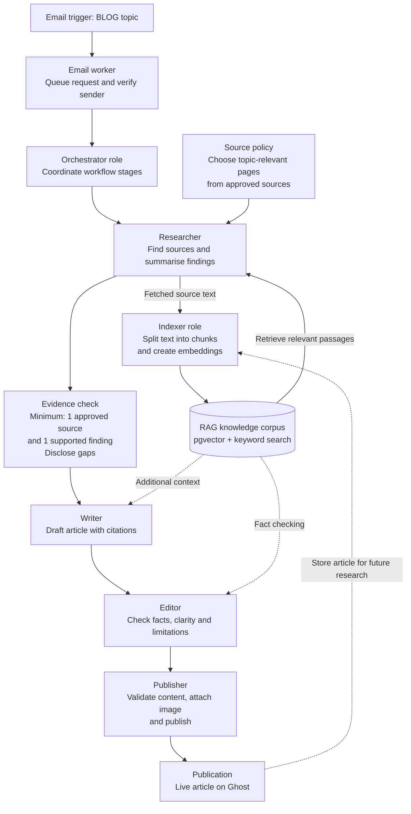

# Email-to-publication pipeline

``cmd + shift + v to preview``

This diagram shows the `BLOG:` email workflow and the revised source policy in
the workspace. Deployment of that policy to the Railway worker is pending.

**RAG** retrieves relevant material from the stored knowledge corpus to support
research, writing and fact checking.

For email-triggered posts, Python performs the **Orchestrator** and **Indexer**
roles directly. Researcher, Writer, Editor and Publisher are AI agents. After
Ghost publication, the worker handles LinkedIn sharing and newsletter delivery,
then indexes the final article for future retrieval.

The evidence policy permits a scoped article with one approved source and one
supported finding. It prefers two independent publishers, carries unanswered
questions forward as disclosed gaps, and omits unsupported findings. An article
still needs a visible citation to its approved research evidence.
